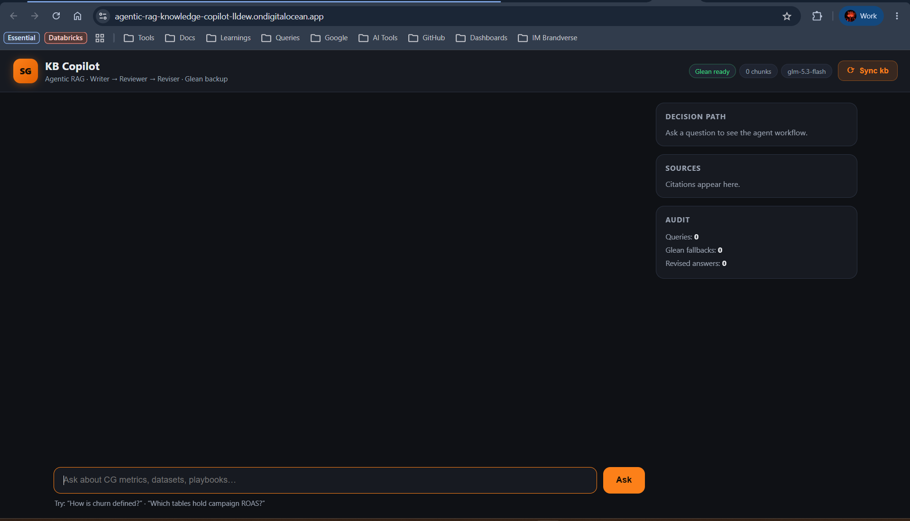

# Agentic RAG Knowledge Copilot

Agentic RAG chat over a **multi-branch git knowledge base** (any repo of
Markdown/YAML docs where each branch is a domain or function), combining two
patterns:

- **Enterprise Agentic RAG** — the graph *decides what to do next*:
  route → retrieve → grade evidence → **backup search** when evidence is weak →
  rewrite & retry, with a visible decision path and a SQLite audit trail.
- **Self-Correcting Multi-Agent System** — a writer → reviewer → reviser loop
  polishes every grounded answer (max 3 revisions), returning the full event trace.

```
Question ─▶ Router ─▶ Retriever (Chroma + MiniLM over the KB)
                          │
                    Evidence Grader ──GOOD──▶ Writer ─▶ Reviewer ─PASS─▶ Answer
                          │ WEAK                 ▲            │
                          ▼                      │          REVISE
                    Backup Search (Glean) ─GOOD──┘            ▼
                          │ WEAK                         Reviser ─▶ Reviewer
                          ▼
                    Query Rewriter ─▶ retry retrieval (max 2)
```

## Why this structure is unique (and better for RAG)

Most RAG demos are a straight pipe: `question → embed → top-k → LLM → answer`.
That fails quietly in production — it hallucinates over weak evidence, never
retries with a better query, and gives you no way to see *why* an answer is
wrong. This project is built around three structural differences:

**1. The pipeline is a state machine, not a pipeline.**
Every stage is a decision point with conditional edges (`app/agents/workflow.py`).
Retrieval results are *graded* by an LLM judge before generation; weak evidence
routes to backup search (Glean), then to a query rewriter that reformulates and
retries retrieval — up to `MAX_RETRIEVAL_RETRIES` times. The graph can loop,
branch, and give up honestly ("context is insufficient") instead of inventing
an answer. The control flow *is* the quality control.

**2. Generation is self-correcting, not one-shot.**
The Writer's draft is never shown to the user as-is. A Reviewer scores it for
grounding (every claim must trace to a cited chunk) and clarity, returning
structured `{"decision": "PASS|REVISE", "feedback": ...}`; a Reviser applies
the feedback and resubmits, up to `MAX_REVISIONS`. This costs a few extra LLM
calls but catches the two classic RAG failures — unsupported claims and
citation drift — *before* the answer ships. Every revision is visible in the
UI's decision-path timeline, so trust is auditable, not assumed.

**3. The knowledge base is a git repo, so freshness is a diff, not a rebuild.**
Classic RAG treats the corpus as a static pile of files: updating it means
re-running the whole ingestion, and there's no notion of *what changed*.
Here the corpus is a multi-branch git repository (mirroring how real orgs
actually own knowledge — one branch per domain/function, 50+ in the source
deployment). Ingestion dedupes identical content across branches by SHA-1 and
persists a hash manifest (`data/index_state.json`), so the Sync button runs
`git fetch` → re-enumerate → hash-diff → **embed only the changed documents,
delete the removed ones**. A fresh commit on any branch is reflected in
retrieval in seconds, and the reindex cost scales with the *diff*, not the
corpus. It's incremental indexing with git as the change-feed — no webhooks,
no pipeline infra, just the version control you already have.

The stack reinforces the same goal: everything (fastembed ONNX embeddings,
Chroma, cookie-based Glean SSO) runs free and local-first, so the only external
dependencies are the LLM gateway and your own knowledge source.

## Stack (all free)

| Layer | Choice | Why |
|---|---|---|
| LLM | Any OpenAI-compatible gateway via **Portkey headers** | one provider for all agents; swap with one env var |
| Embeddings | **fastembed** `all-MiniLM-L6-v2` (ONNX, CPU) | no torch, no API, free |
| Vector store | **Chroma** (local, persistent) | zero-setup, cosine HNSW |
| Backup search | **Glean** — cookie-based SSO, **no API key** | Chrome auto-extract via `browser-cookie3`, `.env` fallback |
| Orchestration | **LangGraph** | conditional edges = the agentic control |
| API / UI | FastAPI + vanilla HTML/CSS/JS | dark chat UI with decision-path timeline |

## How ingestion works

The KB is a **git repository with one branch per domain** (the original used
50+ function branches). The reader never checks branches out — it walks
`git ls-tree`/`git show` over every branch, keeps `.md`/`.yaml` files, dedupes
identical content across branches by SHA-1, and records
`{path, branches[]}` metadata per chunk.

### The Sync button

The header **⟳ Sync kb** button runs `POST /api/reindex`: `git fetch`,
re-enumerate every branch, hash-diff every knowledge file, embed only
new/changed documents, delete removed ones. A fresh commit on any branch is
reflected in retrieval within seconds — no rebuild, no restart.
State lives in `data/index_state.json`.

## Demo

The app is deployed on DigitalOcean App Platform — full walkthrough (chat, the
decision-path timeline, Glean fallback, and a live Sync-kb reindex) in the
**[demo video](https://drive.google.com/drive/folders/1oKuCmmisvdlCArkxkmO3w7xOHBGj6kZd)**.



## Local setup

```bash
python -m venv .venv
.venv/Scripts/pip install -r requirements.txt   # Windows
copy .env.example .env                          # fill in values (below)
.venv/Scripts/python ingest_cli.py              # first index build
.venv/Scripts/python run.py                     # http://localhost:8000
```

### .env values

- `ANTHROPIC_API_KEY` / `ANTHROPIC_BASE_URL` / `PORTKEY_API_KEY` / `PORTKEY_PROVIDER`
  — your LLM gateway (any Portkey-proxied OpenAI-compatible endpoint).
- `LLM_MODEL` — the gateway's model id used by all three agents
  (per-agent overrides: `WRITER_MODEL`, `REVIEWER_MODEL`, `REVISER_MODEL`).
- `KB_LOCAL_PATH` — local clone of the knowledge-base git repo.
- `GLEAN_SERVER_URL` + `GLEAN_SESSION_COOKIE` / `GLEAN_AZURE_COOKIE` — your Glean
  instance. Cookies from DevTools → Application → Cookies (expires ~24 h;
  alternative: close Chrome and restart the app for auto-extract).
  **No Glean API key needed.**

## DigitalOcean deployment

Ships `Dockerfile` + `do-app-spec.yaml` (App Platform blueprint). Two notes:

1. **KB source** — locally we read a git clone from disk. On App Platform,
   adapt `app/rag/kbreader.py` to `git clone` the private repo at startup
   (`KB_REPO_URL` + fine-grained PAT), and mount a persistent volume for `data/`.
2. **Glean cookies** — session cookies are short-lived; set them as encrypted
   env vars and re-copy when they expire (the UI shows a "Glean no cookies"
   chip instead of failing).

> ⚠️ If your knowledge base is internal data, deploy privately (App Platform
> apps are public by default — add authentication or keep it on an internal
> URL), and never commit the real `.env` or embedded content.

## Project layout

```
app/
├── api/routes.py        # /api/chat · /api/reindex · /api/status · /api/trace
├── core/config.py       # Portkey client factory + rate limiter
├── rag/kbreader.py        # multi-branch git reader (no checkout)
├── rag/ingest.py        # full + incremental hash-diff ingestion
├── rag/vectorstore.py   # Chroma + fastembed
├── tools/glean.py       # cookie-based Glean search/chat (no API key)
├── agents/rag_graph.py  # route / retrieve / grade / glean / rewrite nodes
├── agents/agents.py     # writer / reviewer (structured) / reviser
├── agents/workflow.py   # combined LangGraph + event trace
└── services/audit.py    # SQLite decision log
templates/index.html     static/style.css (dark theme)  static/app.js
```

## Tests

```bash
.venv/Scripts/python tests/test_workflow.py   # graph edges, stubbed LLM
.venv/Scripts/python tests/smoke_llm.py       # live gateway round-trip
```
